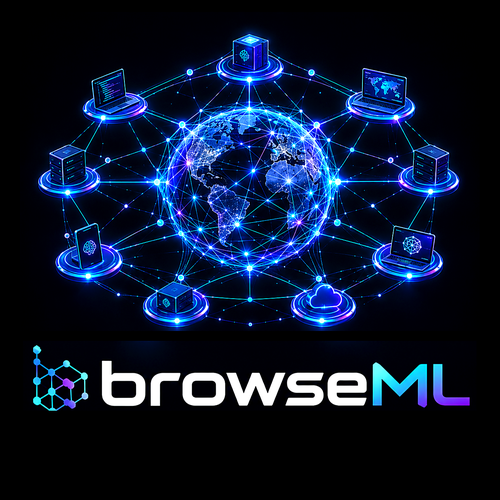

### Machine learning in your browser — verified, with a receipt on every answer

<table>
<tr>
<td width="33%" valign="top">

**Nothing leaves your device**

Your computer does the work. No install, no account, no server.

</td>
<td width="33%" valign="top">

**Verified, with receipts**

The model is checked before it speaks; every answer has a receipt.

</td>
<td width="33%" valign="top">

**Exact before fast**

Identical to llama.cpp's answers, then made fast without changing them.

</td>
</tr>
</table>

### Repositories

<table>
<tr>
<td width="33%" valign="top">

**[browseML](https://github.com/browseML/browseML)**

The product: the engine in the browser, the page, the control panel.

</td>
<td width="33%" valign="top">

**[models](https://github.com/browseML/models)**

Verified model copies: a second source beside Hugging Face.

</td>
<td width="33%" valign="top">

**[webgpu](https://github.com/browseML/webgpu)**

Exact WebGPU kernels, proved bit for bit on your GPU.

</td>
</tr>
<tr>
<td width="33%" valign="top">

**[persona](https://github.com/browseML/persona)**

Who browseML is, and the facts it answers from.

</td>
<td width="33%" valign="top">

**[embeddings](https://github.com/browseML/embeddings)**

Search in the browser: BM25 now, meaning next.

</td>
<td width="33%" valign="top">

**[bankML](https://github.com/cryptoAGI/bankml)**

The engine: 1-bit models, bit-exact, a receipt on every answer.

</td>
</tr>
</table>

### Try it

**[PYTHAI/browseML](https://huggingface.co/spaces/PYTHAI/browseML)** · [PYTHAI/bankml](https://huggingface.co/spaces/PYTHAI/bankml) · [PYTHAI/bankML-UIF](https://huggingface.co/spaces/PYTHAI/bankML-UIF)

Built on <a href="https://github.com/cryptoAGI/bankml">bankML</a> by Professor Codephreak and Gregory L. Magnusson (<a href="https://github.com/cryptoAGI">cryptoAGI</a>) · MIT OR Apache-2.0 · Created using Bonsai by Prism ML
